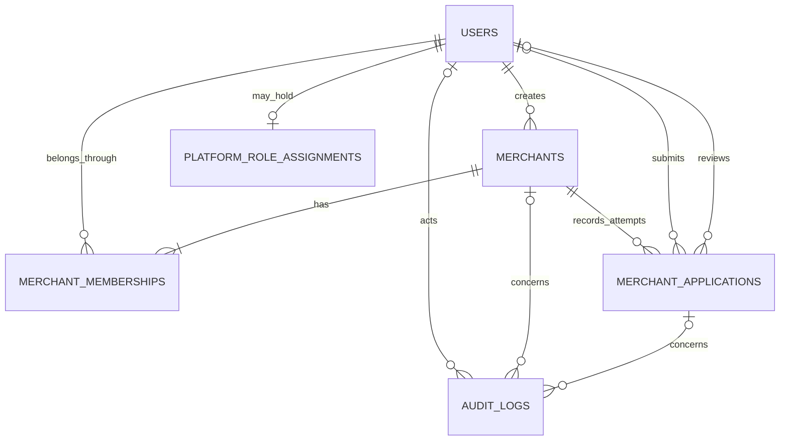
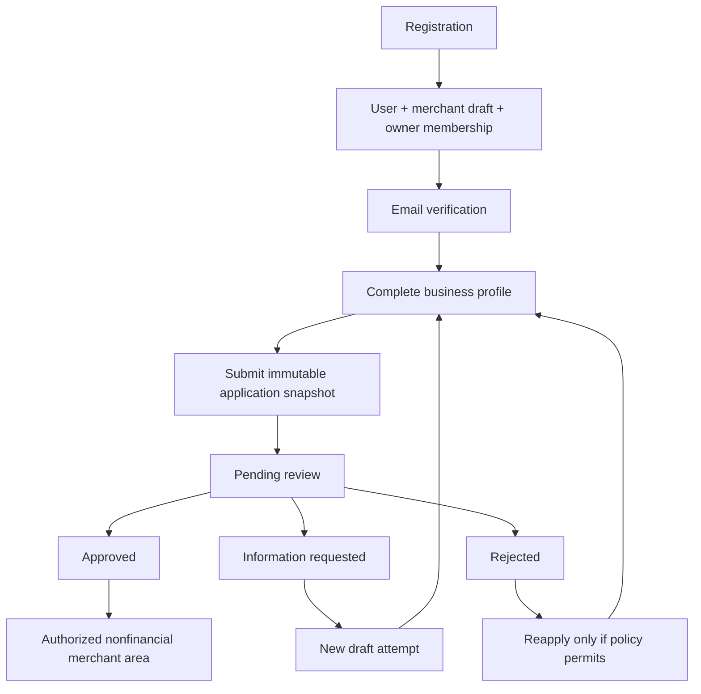

# XLipa — Phase 3 Stage A: Architecture na Implementation Plan

Tarehe: 6 Novemba 2026, Africa/Nairobi.

Canonical root: `C:/Users/hp/OneDrive/Desktop/WEB-DEVELOPMENT/XLipa`.

**Status: proposal ya kuidhinishwa, si implementation.** Stage A imekagua code na mazingira, ikasoma audit, Phase 2 report na README. Hakuna application code, dependency, schema, administrator account au feature mpya iliyobadilishwa/kuundwa. File mpya pekee ni report hii.

Mmiliki amethibitisha manually kwamba website inafunguka na muonekano unaridhisha. Huo ni owner confirmation, si madai kwamba agent imefanikiwa browser automation: historical browser-tool limitation bado imerekodiwa kwenye Phase 2 report. Design iliyopo ihifadhiwe wakati wa Stage B.

**Pendekezo kuu:** Laravel modular monolith iliyopo; native session authentication; many-to-many user–merchant memberships; platform roles tofauti na merchant roles; versioned application attempts; server-side policies; audit events ndani ya transaction ya mabadiliko. Hakuna payment, ledger, balance, API credentials au provider integration katika Phase 3.

## A. Existing Backend Assessment

### Kilichothibitishwa sasa

| Eneo | Current implementation na evidence |
|---|---|
| Runtime | PHP 8.5.12; Laravel 13.35.0; PHPUnit 12.5.38; `composer show --direct` |
| Dependencies | Framework, Tinker na development tools; hakuna Fortify, Sanctum au third-party permission package kwenye direct dependencies; `backend/composer.json` |
| Security audit | `composer audit --locked --format=json`: advisories `[]`, abandoned `[]` wakati wa Stage A |
| Routes | GET/HEAD routes 11: root + XLipa HTML pages 10; hakuna auth POST, merchant au admin endpoints; `backend/routes/web.php` |
| User model | Authenticatable + Notifiable, hashed password cast, hidden password/remember token; `MustVerifyEmail` haija-implementiwa; `backend/app/Models/User.php` |
| Auth configuration | `web` session guard + Eloquent User provider; password broker table ipo, expire 60 minutes na throttle 60 seconds; `backend/config/auth.php` |
| Database | SQLite ya canonical backend; tables 9 zilizo chini; read-only count: **users 0**, normalized-email collision groups 0 |
| Local configuration | `local`, debug false, `http://xlipa.test`, SQLite, file sessions/cache, sync queue, log mailer; local `.env` imekaguliwa bila kuchapisha secrets |
| Tests | Existing PHPUnit suite: **16 passed / 80 assertions**, rerun katika Stage A; si tests za future auth/merchant features |
| Frontend | Registration/sign-in zina CSRF placeholders, lakini submit scripts ni demo; `frontend/xlipacreateaccount.html:182`, `:219`; `frontend/xlipasignin.html:203`, `:234`, `:235` |
| Source ownership | `frontend/*.html` ni canonical; `scripts/Sync-Frontend.ps1` huzalisha `backend/resources/views/xlipa/*.blade.php`. Backend-only edits za generated views zinaweza kupotezwa na sync |

Foundation tables zilizopo: `users`, `password_reset_tokens`, `sessions`, `cache`, `cache_locks`, `jobs`, `job_batches`, `failed_jobs`, `migrations`.

Migration history imethibitisha filenames tatu pekee: `0001_01_01_000000_create_users_table`, `0001_01_01_000001_create_cache_table`, `0001_01_01_000002_create_jobs_table`. Schema source ni `backend/database/migrations/`. User IDs ni bigint/integer; email ina unique index. `sessions.user_id` ina index lakini haina FK. Hakuna merchant tables, business controllers, policies au authorization services katika `backend/app/`.

Default Laravel facilities zilizopo **si authentication workflow iliyokamilika**: hakuna login, reset delivery, email verification, platform access au merchant isolation inayofanya kazi bado. SQL ya hosting imeachwa untouched; hakuna production database iliyounganishwa.

### Uhakiki wa Stage A

Commands zilizofanywa: file/config/form reads, `rg`, `git status --short`, PHP `-v`, Composer `show --direct`, `audit --locked --format=json`, Artisan `route:list --except-vendor`, PHPUnit `--no-progress --do-not-cache-result`, read-only SQLite table/migration/count inspection na hash reads. PHPUnit inaweza kuandika temporary runtime sessions/cache; hakuna migration au business data mutation iliyofanywa.

Kwa kuwa user table ni empty sasa, hakuna known existing-user data migration conflict. Stage B lazima ihakiki tena hali hii: usi-assume itabaki empty baada ya approval.

## B. Proposed Database Schema

**Scope inayopendekezwa kwa Stage B: update moja ya `users`, tables mpya tano.** Verification documents ni future design tu; hakuna document table/upload katika Stage B default scope. Usiongeze generic permissions, invitations, customers au financial tables sasa.

Conventions: UTC timestamps; FK types zinazolingana; non-null kwa required attributes; bounded strings; indexed tenant/status queries; PHP backed enums kwa states/roles; database allowed-value constraints pale grammar/engine inavyoruhusu, pamoja na portable tests. Hakuna schema SQL inayotakiwa kutekelezwa kutoka report hii.

### 1. `users` — existing table, additive changes

Hifadhi `id`, `name`, `email`, `email_verified_at`, `password`, `remember_token` na timestamps. Ongeza:

| Field | Type/default | Sababu |
|---|---|---|
| `account_status` | bounded string: `active`, `suspended`, `closed`; default `active` | User suspension itenganishwe na email verification na merchant status |
| `auth_version` | positive integer, default 1 | Kurevoke existing file sessions bila kutegemea kuorodhesha session files |
| `terms_version` | nullable bounded string kwa pre-existing users | Record ya terms version iliyokubaliwa; server ndiyo huchagua version |
| `terms_accepted_at` | nullable UTC timestamp kwa legacy rows | Server timestamp ya registration consent |

Email i-normalize kwa trim + lower-case kwa product policy iliyopendekezwa, kabla ya validation/storage/login/reset. Existing unique index ibaki; concurrent duplicate insert ikamatwe salama. Validation na model normalization zitumike kwa write paths zote; raw direct SQL writes hazitachukuliwa kuwa supported application path. Backfill itahitaji collision report na approval ikiwa users wataonekana. Lower-casing local part ni deliberate product decision ya kuidhinisha, si universal email rule. Initial scope ni conventional email addresses; EAI/internationalized mailbox support ni review tofauti.

Hakuna `is_admin`, merchant role au merchant_id ndani ya users. Account inaweza kuwa active lakini email haijaverifyiwa; hiyo si approval ya merchant. Hard-delete ya identity haitolewi katika Phase 3; closure/suspension zihifadhi audit relationships.

### 2. `merchants`

| Field | Proposed definition |
|---|---|
| `id` | ULID primary key, server-generated |
| `business_name` | string(200), required; si globally unique |
| `business_type` | nullable wakati wa initial draft; approved allowlist ya business types kabla ya submit |
| `registration_country` | nullable ISO country code, required inapohusika |
| `registration_number` | nullable normalized bounded string; required kulingana na business type |
| `business_email`, `business_phone` | bounded nullable strings kabla ya profile completion; phone iwe normalized E.164 |
| `address_line1`, `address_line2`, `city`, `region`, `country_code`, `postal_code` | structured nullable columns kwa draft; required subset kulingana na profile rules |
| `operational_status` | `onboarding`, `enabled`, `suspended`, `closed`; default `onboarding` |
| `verification_status` | `unverified`, `pending`, `needs_information`, `verified`, `rejected`; default `unverified` |
| `profile_version` | positive integer, default 1; increment kwa material profile edit |
| `created_by_user_id` | FK users.id, historical creator; si ownership authorization source |
| `created_at`, `updated_at` | timestamps |

Indexes: `(operational_status, created_at)`, `(verification_status, updated_at)`, `(registration_country, registration_number)` kwa duplicate review. Registration-number uniqueness **haitawekwa blindly**: legal entity inaweza kuwa na branches/merchant accounts zaidi ya moja. Policy ya duplicate legal entities inahitaji approval kabla ya stronger constraint.

ULID inafaa kwa merchant URLs na future integrations bila kubadilisha existing User PK. Ina space kubwa kuliko bigint na inaweza kuonyesha approximate creation ordering; si secret wala authorization protection. Alternative ya bigint + public ULID column ina indexes mbili na complexity zaidi; haipendekezwi kwa new merchants sasa.

### 3. `merchant_memberships`

`id` bigint PK; `merchant_id` ULID FK; `user_id` bigint FK; `role` = `owner|manager|staff`; `status` = `active|revoked`; `created_by_user_id` nullable FK kwa initial system event; timestamps na `revoked_at` nullable.

Constraints: unique `(merchant_id, user_id)`; indexes `(user_id, status)`, `(merchant_id, role, status)`. FKs zitumie restrict kwa deleting identities/merchant records zinazohusiana na history. Revoked membership ibaki kwa evidence na conflict checks; reactivation ifanywe na authorized action, si new duplicate row.

Every merchant lazima apate active owner katika same transaction ya creation. Last-owner revoke/demotion ikataliwe chini ya locked merchant row. Invites, owner transfer na team-management UI **zimeahirishwa**; schema na policies zitazipokea baadaye. Stage B ordinary owner hawezi kuongeza owner mwingine kwa arbitrary form field.

### 4. `platform_role_assignments`

`user_id` bigint primary/FK; `role` = `chief_admin|admin`; `granted_by_user_id` nullable FK kwa bootstrap pekee; `granted_at`; `revoked_at` nullable; timestamps.

One current role record per user inatosha kwa fixed roles mbili; revoke/regrant history ihifadhiwe kwenye audit. Nullable grantor inakubalika tu katika explicit CLI bootstrap action, si public request. Hakuna dynamic role/permission editor au third-party RBAC tables zinazohitajika sasa.

Platform role haitoi merchant membership, na membership haitoi platform role. Suspension ya user inazuia privileges zote. Last active Chief Admin kuondolewa isikubalike katika normal management path; hii iwe transactionally checked na concurrency-tested kabla ya role-management endpoints kuongezwa.

### 5. `merchant_applications`

| Field | Proposed definition |
|---|---|
| `id` | ULID PK |
| `merchant_id` | ULID FK merchants.id |
| `attempt_number` | positive integer, unique per merchant |
| `current_slot` | nullable small integer; `1` kwa current attempt, `NULL` kwa historical attempts |
| `status` | `draft|pending_review|information_requested|approved|rejected` |
| `profile_version` | version ya submitted merchant profile |
| `profile_snapshot` | nullable encrypted TEXT cast to array; required wakati wa submission, bounded allowlist ya profile fields |
| `submitted_by_user_id`, `submitted_at` | nullable hadi submit; FK users.id |
| `reviewed_by_user_id`, `reviewed_at` | nullable hadi decision; FK users.id |
| `public_feedback` | bounded merchant-visible text, nullable |
| `internal_review_notes` | encrypted TEXT, admin-only, nullable |
| `created_at`, `updated_at` | timestamps |

Constraints: unique `(merchant_id, attempt_number)`; unique `(merchant_id, current_slot)` na allowed value `NULL|1`, ili kuwe na current attempt moja. SQLite na proposed future MariaDB target huruhusu multiple NULLs kwenye unique key; behavior hii lazima ipimwe kabla ya database portability sign-off. Indexes `(status, submitted_at)` na `(merchant_id, created_at)`.

Draft inaweza kuhaririwa. Submission hufreeze `profile_snapshot` na `profile_version`; submitted snapshots hazibadilishwi. Approval/rejection/information request hufunga review ya attempt hiyo. Resubmission hutengeneza **attempt mpya**, ikihamisha old current_slot kuwa NULL na mpya kuwa 1 katika transaction moja. Hivyo maombi ya zamani na reviewer feedback havipotei.

`submitted` si state nyingine inayodumu bila sababu: submission ni event yenye timestamp, inayopeleka application moja kwa moja `pending_review`. `information_requested` huhitaji next draft/attempt, si ku-overwrite submitted evidence. Hili ni deliberate workflow choice la approval.

Snapshot si normalized source of truth ya profile ya sasa: merchant columns ndizo authoritative current profile; encrypted snapshot ni historical evidence ya kilichoreviewiwa. Internal notes zisitumike kama free-form storage ya documents, passwords au tokens.

### 6. `audit_logs`

`id` ULID PK; `event_type` bounded allowlist; `actor_user_id` nullable FK kwa system events tu; nullable `target_user_id`, `merchant_id`, `application_id` FKs; `request_id` correlation identifier; `metadata` bounded JSON ya approved status/role/version changes; `occurred_at` UTC.

Indexes `(merchant_id, occurred_at)`, `(actor_user_id, occurred_at)`, `(event_type, occurred_at)`. Platform events zinaweza kukosa merchant_id. Explicit FK targets zinapendelewa kuliko arbitrary polymorphic model names zisizoweza ku-enforcewa na FK.

Events: merchant creation/submission/decision, membership status/role change, user/merchant suspension, platform role grant/revoke, sensitive admin action. Actor, previous state na timestamps zitokane server-side. Business mutation na success audit insert viwe katika same transaction; audit failure ifanye rollback ya sensitive action. Denied attempts ziende kwenye separately redacted security log.

Append-only application access; hakuna edit/delete endpoint. Hii **si tamper-proof storage** dhidi ya privileged DB operator. External immutable export na retention governance ni future operational work. Passwords, reset/verification URLs, CSRF/session tokens, full request bodies na document contents zisiingizwe.

### Verification documents — future design, not a Stage B migration

Future `verification_documents`: ULID id; merchant_id; application_id; uploader/reviewer FKs; type; random storage key; MIME/size/checksum; scan/review states; upload/review/retention/legal-hold timestamps. Enforce document–application–merchant consistency kupitia composite FK au equivalent invariant, si client-supplied merchant ID.

Storage iwe dedicated private disk, random filenames, encrypted at rest kwa managed keys, authorized streaming/download na content disposition ya attachment. No public symlink/direct URL. MIME/extension/size allowlist, malware scanning na access audit viwe prerequisites kabla ya accepting actual KYC files. Retention/deletion schedule na legal holds ziidhinishwe kabla ya collection; report hii haiweki legal retention duration au kudai compliance.

## C. Entity Relationships and ERD

ERD inaonyesha Stage B proposal tu; documents, payments na team invitations hazijachanganywa nayo. Draft applications zina nullable submitter/reviewer hadi events husika. Each merchant creation service itaunda draft attempt na owner membership atomically, hata kama schema inaruhusu zero applications kabla ya transaction kukamilika.

One user anaweza kuwa owner kwa A, manager kwa B na staff kwa C. Role yake ya A haitatumika kwa B. Chief Admin ni assignment tofauti inayotathminiwa katika admin policy path, si implied merchant ownership.

## D. Authentication Architecture

### Chaguo na sababu

| Approach | Tathmini kwa XLipa |
|---|---|
| Native Laravel web guard, Auth/Hash/Password facilities + focused controllers | **Inapendekezwa sasa**; existing frontend inabaki, hakuna new dependency, flows zinakuwa explicit na testable |
| Laravel Fortify | First-party headless alternative yenye established auth/MFA flows; inahitaji dependency/config review, custom view wiring na route decisions. Ina thamani hasa kabla ya privileged MFA activation |
| Starter kit yenye frontend mpya | Inaongeza redesign/framework coupling isiyohitajika kwa existing XLipa HTML |
| Sanctum/JWT/token auth | Haitakiwi kwa server-rendered browser foundation hii; future merchant API itapangwa tofauti |

Manual controllers hazitaandika password crypto, token broker au session protocol upya. Zitaorchestrate Laravel facilities zilizopo. Laravel inaeleza session regeneration baada ya login na logout/invalidation/token regeneration; hizi ndizo flows zitakazotumiwa. [Laravel authentication](https://laravel.com/docs/13.x/authentication).

Fortify inaweza kutumia custom views na kusaidia two-factor authentication; si lazima kusakinisha starter-kit design. Ikichaguliwa baadaye, native controllers zisibaki duplicated pamoja nayo. [Fortify](https://laravel.com/docs/13.x/fortify). Hakuna package iliyoongezwa katika Stage A, na compatibility ya Fortify package version haijatangazwa kuwa imethibitishwa na Composer resolver.

### Proposed routes

Hizi ni proposals tu; current routes bado hazina endpoints hizi.

| Route | Protection/behavior |
|---|---|
| Existing GET `/xlipacreateaccount.html`, `/xlipasignin.html` | Guest views; names `register`/`login` kwa middleware redirects; URLs za existing navigation zibaki |
| POST `/register` | guest, CSRF, registration limiter, server validation |
| POST `/login` | guest, CSRF, login limiter; generic failure |
| POST `/logout` | auth + CSRF; invalidate session na regenerate CSRF token |
| GET/POST `/forgot-password` | guest; generic response, rate limit, broker |
| GET `/reset-password/{token}`, POST `/reset-password` | guest; broker validation, CSRF on POST, expiry/single use |
| GET `/email/verify` | auth, notice + resend control |
| GET `/email/verify/{id}/{hash}` | auth, signed URL, throttle; user/hash binding |
| POST `/email/verification-notification` | auth + CSRF + resend limiter |
| GET/POST `/confirm-password` | auth; short-lived reauthentication kwa sensitive actions |
| GET `/account` | auth + active user; verification/onboarding status landing, si financial dashboard |
| `/merchants/{merchant}/...` | auth + active + verified + membership/policy; merchant context checked |
| `/admin/...` | auth + active + verified + platform permission + reauthentication kwa mutations |

Auth flow: registration validates → transaction creates user/initial merchant/owner/draft → commits → dispatch registered notification → uniform guest response ya check-email/sign-in. Hakuna automatic login baada ya registration. User aki-login, session inaregenerateiwa na unverified user anaelekezwa verification notice; signed verification URL inakamilika baada ya authentication. Initial merchant ni **draft reservation**, ili existing business-name/phone fields zisipotee; business-profile editing/submission kunahitaji verified email. Additional merchant creation pia kunahitaji verified user.

Password rules za proposal: angalau 12 characters; reject passwords zinazozidi bcrypt safe byte limit badala ya silent truncation, ikiwa existing bcrypt configuration itaendelea. Hash algorithm/work factor ithibitishwe kabla ya implementation; hakuna blind algorithm switch. Hakuna third-party password-check request local kwa default. Passwords zisitunzwe/kurudishwa kwenye validation old input au logs.

Password reset itatumia existing broker/table, hashed tokens, 60-minute expiry na existing 60-second resend throttle. Invalid/expired/used tokens zikataliwe. Rotate remember_token na increment auth_version baada ya reset; old file sessions zikataliwe next protected request. [Laravel password broker](https://laravel.com/docs/13.x/passwords).

`User` i-implement `MustVerifyEmail`; protected onboarding itumie verified middleware na signed verification flow. Unverified account iruhusiwe verification notice, resend na logout pekee katika protected onboarding area. [Laravel verification](https://laravel.com/docs/13.x/verification).

Account suspension iactivate server-side check kila protected request, si login pekee. Session ihifadhi login auth_version na middleware ilinganishe na current user record. Persistent remember-me haitawashwa katika initial Stage B; hidden remember control iliyopo haitapanua security scope. Password/role/status-sensitive changes zitahitaji reauthentication na revocation policy. Redirect destinations ziwe internal allowlisted routes.

### Minimal frontend wiring

| Existing field/behavior | Stage B change inayopendekezwa |
|---|---|
| `fullName` | Validate/map kwa users.name |
| `businessName` | Validate/map kwa initial merchant.business_name |
| `email` | Canonical identity email; business email ijazwe explicitly kwenye profile baadaye |
| `phone` | Validate/normalize kama merchant.business_phone; si verified phone identity |
| `password`, `confirmPassword` IDs | IDs na reveal controls zibaki; confirmation input name iwe `password_confirmation` ili kutumia standard validation |
| Terms checkbox isiyo na name | Ongeza `name="terms"`, server-side `accepted`; server-recorded policy version/time |
| Form isiyo na POST action | Ongeza named-route action + method POST; CSRF hidden field ibaki |
| Demo submit handlers | Replace kwa backend form submission, escaped errors na existing notice styling; password reveal/menu scripts zibaki |
| Forgot-password mailto | Link kwenda actual reset-request screen; wording na styling zibaki |

Password minlength/hint inahitaji minimum correction kutoka 8 kwenda approved policy (proposal 12); hii ni security wording change ndogo ya approval, si marketing redesign. Map validation errors kwa existing labels/IDs; name/email/business/phone pekee ziwe old input. `password_confirmation` na legacy `confirmPassword` zisiflashwe. Rendering itumie escaped Blade syntax, si raw HTML kutoka user input.

Dynamic auth wiring iandikwe kwenye canonical `frontend` source templates, kisha sync ifanywe. Usiweke backend-only fixes kwenye generated `xlipa/*.blade.php`. New reset/verification/profile/status screens ziwe owned Blade views nje ya generated folder, zikitumia existing XLipa assets; hakuna homepage/content redesign.

## E. Merchant Onboarding Workflow

State separation:

| Event | Application | Verification | Operational |
|---|---|---|---|
| Register/create merchant | draft | unverified | onboarding |
| Valid submit | pending_review | pending | onboarding |
| Admin asks information | information_requested | needs_information | onboarding |
| Admin rejects | rejected | rejected | onboarding |
| Admin approves current snapshot | approved | verified | enabled, ikiwa merchant si suspended/closed |
| Suspend approved merchant | approved history remains | verified history remains | suspended |
| Material approved-profile change | new draft attempt | unverified | onboarding kwa merchant aliye enabled; suspended/closed haziondolewi na edit |

Suspension isiwe automatic consequence ya rejection: ni operational enforcement tofauti. Approval isiondoe suspension. Reinstatement ni explicit authorized action yenye audit; si resubmission loophole. Closed merchants hazifunguliwi kwa owner edits.

Material profile edit baada ya approval (business identity/registration/primary contacts/address) iondoe current verification na ihitaji fresh review. Pending-review profile iwe read-only mpaka decision, badala ya reviewer kuapprove stale snapshot. `profile_version`, expected current status na transaction concurrency checks zilinde decision races; stale approval irudishe conflict, si overwriting state.

Submission inahitaji active verified user, owner membership, complete validated profile na merchant isiyoruhusiwa kupita suspended/closed restrictions. Owner hawezi kuandika status/reviewer fields. Administrative review ikatae self-review ikiwa reviewer ni submitter au amewahi kuwa member wa merchant hiyo. Hakuna Chief Admin global bypass ya conflict rule.

Approved/enabled inaruhusu nonfinancial account/profile access tu katika Phase 3. **Hakuna payment route/capability inayotengenezwa au ku-enablediwa**, hata kwa approved merchant.

## F. Roles, Permissions and Tenant Isolation

| Action | Chief Admin | Platform Admin | Merchant Owner | Manager | Staff |
|---|---|---|---|---|---|
| Review independent merchant application | Ndiyo, no self-review | Ndiyo, no self-review | Hapana | Hapana | Hapana |
| Approve/reject/request information | Ndiyo + recent reauth | Ndiyo + recent reauth | Hapana | Hapana | Hapana |
| Suspend/reinstate merchant | Ndiyo + recent reauth | Hapana kwa initial scope | Hapana | Hapana | Hapana |
| Grant/revoke platform role | Controlled CLI process | Hapana | Hapana | Hapana | Hapana |
| Edit own merchant draft profile | Kwa membership, si platform role pekee | Kwa membership | Ndiyo | Ndiyo kwa granted merchant | Hapana |
| Submit/reapply | Kwa owner membership, subject to conflict | Kwa owner membership | Ndiyo | Hapana kwa initial scope | Hapana |
| Read own merchant safe summary/status | Kwa membership au explicit admin review policy | Explicit admin review policy | Ndiyo | Ndiyo | Limited non-sensitive summary |
| Read internal review notes/platform audit | Ndiyo kwa authorized scope | Review-scoped only | Hapana | Hapana | Hapana |
| Manage staff invitations/owner transfer | Future separate scope | Future separate scope | Future separate scope | Hapana | Hapana |

Manager/staff roles zinaweza kufanyiwa factories/policy tests sasa bila kujenga invite/team UI. Kuwepo kwa Chief/Admin assignment hakumaanishi row zote zote zinaweza kuhaririwa. Usitumie blanket `Gate::before` inayorudisha true kwa Chief Admin.

Enforcement: `auth` → active-account/auth-version check → verified → resolve authorized merchant context → policy/action. Merchant ID ya route/form/hidden field si permission. Resolve kwa user membership query na active status, halafu scope nested application chini ya merchant; reject mismatched IDs. Tumia scoped bindings pamoja na policies, si mojawapo pekee. Not-found kwa cross-tenant resource, forbidden kwa known resource action isiyoruhusiwa; authenticated admin queries yawe separate na explicitly authorized.

Laravel policies zinafaa kwa resource-specific checks; gates kwa capabilities zisizo model-specific. [Laravel authorization](https://laravel.com/docs/13.x/authorization). Usifiche tenant filtering kwenye global scope pekee: CLI, jobs na admin queries zinaweza kuibypass. Membership/status zisomwe fresh kila request; route/query filters na service checks pia zitumike kwenye background paths.

Mass assignment: FormRequest allowlists na explicit DTO/action arguments; reject/ignore role, account_status, verification_status, current_slot, merchant_id reassignment, reviewer_id na audit actor fields kutoka browser. DB constraints ni last defense, si replacement ya policy.

## G. Administrator Architecture

Admin foundation iwe namespaced policies/actions na restricted review endpoints, **si large dashboard**. Default proposal: minimal session-authenticated review JSON endpoints kwa list/detail/decision, authorized audit read, na tests; operator-facing dashboard UI ihitaji approval tofauti. Internal notes zisitolewe kwenye merchant serializers au generic model JSON.

Hakuna public administrator-registration route au hardcoded credentials. Proposed CLI command `xlipa:provision-chief` ipokee existing user identity, ihakiki active na verified user, ionyeshe target kwa interactive confirmation, kisha transaction ya grant + audit. Isiweke password kwenye command line, logs au seeders. Command haifanyi email verification bypass, na isi-create initial account yenye guessed credentials. Repeat grant iwe safely idempotent. Production provisioning itahitaji separate operational approval/access review; Stage B tests zitumie isolated synthetic users.

Chief/Admin review mutations zihitaji recent password confirmation (proposal window: 5 minutes), verified email, policy na audit. **Privileged mutations outside local/testing zifail closed mpaka approved MFA control na secure HTTPS deployment viwe tayari.** Fortify-backed MFA ni supported alternative ya kuidhinisha kabla ya real admin use; usijenge homemade TOTP crypto. Hakuna real administrator atakayeprovisioniwa kama implicit consequence ya architecture approval.

Self-review, review ya stale snapshot, double decision na concurrent updates zikataliwe. First successful transition ndiyo authoritative; subsequent duplicate decision isiunde duplicated success audit/notification. Role-management ya mwisho wa chief ikiongezwa baadaye ihakiki last-chief invariant ndani ya transaction, si count ya kabla ya lock.

## H. Security Controls

- **Authentication:** framework Hash/Password/session facilities, generic invalid-credentials response; active status checked kila request. No plaintext passwords, no sensitive old input.
- **Enumeration:** reset na registration duplicate-email responses zisiwe explicit “account exists.” Fresh-registration na duplicate response ziwe same generic next-step screen, status na guest/session outcome. Existing email isipate duplicate account/merchant. Baada ya register, **hakuna auto-login**; onyesha same generic check-email/sign-in response, kisha normal login. Timing differences bado ni residual risk inayohitaji rate limiting na targeted tests; uniform text pekee haitathibitisha full enumeration resistance.
- **Registration transaction:** create new user + merchant draft + owner + application + creation audit; failure katika step yoyote ifanye rollback. Guest response isitoe user/merchant ID. Verification email dispatch baada ya commit. Duplicate submissions ziwe harmless; no role escalation.
- **Rate limits, proposal ya ku-tune:** login 5/min kwa normalized-email+IP na 30/min kwa IP; registration 5/hour kwa IP; reset/resend 1/min kwa target na aggregate 10/hour kwa IP; verification resend 6/min kwa user; application submit 5/hour kwa user+merchant; review mutation 10/min kwa admin. Hashed identifier katika cache keys; tests zi-test reset windows na no permanent lockout. Hizi ni starting policies, si proven production thresholds.
- **CSRF:** web middleware kwa state-changing requests, POST logout, no GET state mutations isipokuwa framework signed verification semantics. No exemptions kwa auth/admin endpoints.
- **XSS:** escaped view fields/validation messages; no raw profile/review HTML; JSON responses with explicit allowlists; unsafe upload/render features haziongezwi.
- **Sessions:** regenerate baada ya login; invalidate na regenerate CSRF baada ya logout. auth_version checked kwa password reset/suspension/relevant role changes. Local file sessions ziendelee; scalable shared store ni future deployment choice. Secure HttpOnly/SameSite cookies na HTTPS ziwe launch prerequisites, si policy ya kupuuza local testing.
- **Profile validation:** business type rules, length limits, country-aware phone normalization; no unvalidated registration number uniqueness assumption; route merchant identity cannot be mass-assigned.
- **Secrets/PII:** local `.env`, private log/email capture access, no SMTP/API secrets committed. No KYC documents au government IDs zitaombwa sasa. Encrypted snapshots/internal notes ziwe na key-management/backup plan; key loss humaanisha data loss.
- **Audit:** success events same transaction; redacted denial/security logs; no tokens, credentials, documents au raw request payloads. Application append-only haijathibitishi regulatory-grade immutable storage.
- **Scope guard:** no BongoPay dependency, no Selcom/API credentials/provider requests, no fabricated balances, no live capability toggles.

### Email na notifications

Existing local `MAIL_MAILER=log` ibaki; tests zitumie Notification/Mail fakes. Verification, reset, submission, approval, rejection na information-request notices zipangwe. Verification/reset ziende kwa identity email; application outcomes kwa authorized owner, bila internal notes au KYC contents kwenye email. Dispatch after commit; local sync/log ndiyo initial transport. Later queued delivery/retry isihusishwe na approval transaction validity.

Verification/reset links ni secrets: zisichapishwe kwenye reports au shared logs/screenshots. Log mailer ni local testing transport, si real email delivery. Real SMTP/testing inbox services zisitumike bila explicit approval; hakuna real email itakayotumwa katika Stage B default scope.

## I. Migration and Rollback Strategy

1. **Stage B architecture approval kwanza.** Baadaye present exact generated migrations, preflight results na explicit target `XLipa/backend/database/database.sqlite` kwa separate execution approval. Architecture approval si blanket approval ya ku-run schema changes.
2. Reinspect existing tables/columns/indexes/history na data counts; reject naming conflicts na unexpected schema. Never edit already-applied `0001_*` migrations. No auto-import ya hosting SQL.
3. Hash/back up local SQLite na sources before migration. Hakikisha app haina active writes; ikiwa WAL/journals zipo, tumia consistent SQLite backup mechanism na restore validation badala ya live file-copy pekee. Backup ishughulikie private env keys bila kuzichapisha. Stage A haijaunda migration backup mpya kwa sababu hakuna schema execution.
4. Proposed migration sequence: `add_account_controls_to_users`; `create_merchants`; `create_merchant_memberships`; `create_platform_role_assignments`; `create_merchant_applications`; `create_audit_logs`. Use actual creation timestamps wakati wa Stage B; names hizi ni proposed basenames.
5. Add user columns kwa compatible defaults; backfill/validate normalized email na collision handling kabla ya stronger constraints. Preserve existing IDs/password hashes; new merchant entities hazibackfilliwi kwa guessed owner/business data. Current users_count 0 haiondoi preflight ya wakati huo.
6. Run migrations kwanza katika **isolated test SQLite**; test up/down/constraints, FK enforcement na unique-current-attempt invariant. Inspect generated SQL na migration status kwenye approved target before execution. Never `migrate:fresh`, `refresh`, `reset` au `composer run setup` kwenye local working data.
7. SQLite haiweki concurrency/locking semantics sawa na future MariaDB. Tumia conditional updates/version checks na transaction retries; `lockForUpdate` pekee haitoshi kwenye SQLite. MariaDB integration/concurrency CI itahitaji separate isolated DB setup approval kabla ya payment-grade readiness.
8. Rollback is not automatically harmless: migration down inaweza kudrop new tables/records. Kabla ya revert baada ya real Stage B use, export/backup new data, approve data-loss risk, ndipo controlled down au consistent backup restore chini ya maintenance window. Reverse dependency order; never erase original SQL backup. Forward corrective migration inaweza kuwa safer kuliko down.

SQL backup ya hosting inabaki historical recovery asset; schema migration source ni existing Laravel migrations pamoja na approved additions. No production MySQL credentials/connection changes katika Stage B default plan.

## J. Testing Plan

Tests zinazofuata ni **planned**, hazijaandikwa wala kupita bado.

| Area | Critical scenarios/acceptance |
|---|---|
| Registration | Valid atomic creation; invalid fields; terms missing; confirmation mismatch; normalized duplicate/concurrent email; generic duplicate response; no client-supplied role/status; failure rolls back merchant/membership/application |
| Login/logout | Correct/incorrect credentials; suspended/closed users; generic errors; limits; session ID change; logout POST/CSRF; invalidated session no longer authorizes |
| Reset | Existing/nonexisting email same public behavior; hashed stored token; expiry; single use; throttle; new password hash; old auth_version sessions rejected; remember token revoked |
| Verification | Signed valid/expired/tampered URL; other-user link denied; resend limiter; unverified profile/submission blocked; verified event and intended redirect safety |
| Merchant/membership | One user multiple merchants; different roles per merchant; atomic owner invariant; duplicate membership constraint; revoked member denied; last-owner protection |
| Workflow | Draft edits; submission freezes snapshot; pending edits denied; info request/rejection preserve history; fresh attempt/current_slot uniqueness; approval current-version only; suspended merchant not re-enabled by review |
| Admin | No public provisioning; merchant cannot escalate; no self-review; admin vs chief boundaries; recent reauth required; nonlocal privileged gate denied without MFA readiness; no actual real admin account creation in tests |
| Isolation/IDOR | Merchant A cannot list/read/edit/submit B; nested wrong application ID; forged hidden/query IDs; manager/staff restrictions; direct service/job paths checked |
| Audit | Same-transaction success log; audit-write failure rolls back action; denial redaction; no password/token/doc content; merchant cannot access internal/admin events |
| Notifications | Fakes/log only; after-commit dispatch; correct intended recipients; no internal notes leakage; no real network provider calls |
| Database | FK/unique constraints, current-attempt races, normalized email conflicts, snapshot/version CAS, additive migration safety in isolated DB |
| Regression | Existing public pages/assets/design; reveal/menu behavior; new backend validation/redirects; no BongoPay network references; absence of payment endpoints |

`phpunit.xml` tayari ina `testing`, `DB_DATABASE=:memory:`, array mail/cache/session na sync queue. New DB-changing feature tests lazima ziguard target ya test connection kabla ya RefreshDatabase; zisifungue canonical local database kwa writes. Existing PhaseTwoFoundationTest ina read-only canonical SQLite integrity check; iwekwe separate/explicit ili future migration tests zisiiweke target ya refresh.

Tests za CSRF zinahitaji middleware enabled katika targeted cases, kwa kuwa normal Laravel test environment inaweza kuibypass. Rate-limit tests zisifanye assumptions kwamba production file-cache behavior inafanana kabisa na test array store. Browser/DOM tests zirekebishwe ku-test real form POST flow; original demo-message assertions zisibaki kama expected functionality baada ya replacement.

No fabricated pass totals: current Stage A baseline tu ndiyo **16 tests/80 assertions passed**. New features zinahitaji new evidence kabla ya Stage B completion.

## K. Files Expected to Change

Paths ni relative kwa canonical `XLipa/`. Hizi ni planned files, **hazijatengenezwa sasa**; small implementation inaweza kuunganisha classes zinazofanana bila excessive abstraction.

| Area | Expected files |
|---|---|
| Existing user/config/routes | `backend/app/Models/User.php`, `backend/routes/web.php`, `backend/bootstrap/app.php`, `backend/app/Providers/AppServiceProvider.php`; `backend/config/auth.php` ikiwa confirmation policy inahitaji update |
| Auth controllers | `backend/app/Http/Controllers/Auth/RegisteredUserController.php`, `AuthenticatedSessionController.php`, `PasswordResetLinkController.php`, `NewPasswordController.php`, `EmailVerificationController.php`, `ConfirmablePasswordController.php` |
| Profile/review controllers | `backend/app/Http/Controllers/MerchantController.php`, `MerchantApplicationController.php`, `backend/app/Http/Controllers/Admin/MerchantApplicationReviewController.php` |
| Requests | `backend/app/Http/Requests/Auth/RegisterRequest.php`, `LoginRequest.php`, reset/confirm request classes; `UpdateMerchantProfileRequest.php`, `SubmitMerchantApplicationRequest.php`, `ReviewMerchantApplicationRequest.php` |
| Models | `backend/app/Models/Merchant.php`, `MerchantMembership.php`, `PlatformRoleAssignment.php`, `MerchantApplication.php`, `AuditLog.php` |
| Enums/policies | `backend/app/Enums/` scoped status/role enums; `backend/app/Policies/MerchantPolicy.php`, `MerchantApplicationPolicy.php`, `AuditLogPolicy.php` |
| Middleware | `backend/app/Http/Middleware/EnsureActiveAccount.php` pamoja na auth-version validation; `ResolveMerchantContext.php`; privileged nonlocal readiness gate ikiwa review endpoints zinafikiwa |
| Focused actions | `backend/app/Actions/Auth/RegisterMerchantOwner.php`; `backend/app/Actions/Merchants/CreateMerchant.php`, `UpdateMerchantProfile.php`, `SubmitMerchantApplication.php`, `ReviewMerchantApplication.php`; `backend/app/Actions/Audit/RecordAuditEvent.php` |
| Provisioning | `backend/app/Console/Commands/ProvisionChiefAdministrator.php` — implementation/testing tu, no real provisioning without separate approval |
| Migrations | New files katika `backend/database/migrations/` zenye basenames sita zilizotajwa section I; no edits za applied originals |
| Notifications | `backend/app/Notifications/MerchantApplicationSubmitted.php`, `MerchantApplicationReviewed.php`; framework verification/reset facilities reused |
| Existing frontend | `frontend/xlipasignin.html`, `frontend/xlipacreateaccount.html`; generated auth Blade copies kupitia sync; no marketing/CSS redesign |
| New minimal views | `backend/resources/views/auth/` reset/verify/confirm screens; `backend/resources/views/account/` landing; `backend/resources/views/merchants/` profile/status; shared XLipa layout extraction ikihitajika bila design change |
| Tests/factories | `backend/tests/Feature/Auth/`, `Merchants/`, `Admin/`, `Security/`; factories za new models; migration/constraint tests; `scripts/Test-Frontend.cjs` demo expectations update |
| Documentation | `README.md`, Stage B completion/change report, updated architecture decision notes |

`composer.json`/lock **hazitarajiwi kubadilika** kwa recommended native approach. Fortify au other package ikihitajika, first propose exact package/version, compatibility/security checks na approval; usi-install silently. `config/filesystems.php` haitabadilishwa kwa document collection katika default Stage B.

## L. Implementation Milestones and Priorities

| Milestone | Scope | Exit gate |
|---|---|---|
| B0 — Preflight | Architecture approval, baseline/source backup, migration files review | Explicit schema-execution approval ya local target |
| B1 — Schema | Additive user controls + five tables, factories/constraints | Isolated migration/rollback/invariant tests; working DB untouched mpaka approval |
| B2 — Identity | Registration, session login/logout, reset, verification, generic outcomes | Auth/limiter/session/notification tests; frontend styling unchanged |
| B3 — Merchant foundation | Membership context, profile, nonfinancial status landing | Tenant/IDOR/mass-assignment tests; multiple merchants supported |
| B4 — Applications/admin foundation | Attempts, review policies/actions, audited decisions, provisioning command tests | No self-review/stale approval; audit atomicity; no public admin signup |
| B5 — Regression/security | Existing/new tests, DOM/browser checks, Composer audit, docs | Actual verification evidence; manual visual sign-off as needed |

Hakuna B-stage inayotakiwa kuanza kabla ya Stage A approval. B0 si ruhusa ya ku-import hosting SQL. Financial dashboards/provider integration/API keys ziko nje ya milestones hizi.

## M. Architectural Risks and Decisions Requiring Approval

### Recommended approval package

1. **Native Laravel session auth**, no new auth/RBAC package; no-auto-login registration yenye uniform guest response, framework reset/verification.
2. **Schema:** preserve existing bigint User IDs; ULID merchants/applications/audit events; additive user controls; five new tables; many-to-many memberships; separate fixed platform roles.
3. **Workflow:** initial draft merchant kutoka existing form; verified-email gate; owner-only submit; immutable submitted attempts; fresh attempt after information request/rejection; material approved-profile changes require re-review; no self-review.
4. **Minimum frontend additions:** POST wiring, escaped validation, terms field name, password-confirmation name, proposed 12-character password policy/hint na new necessary auth/onboarding screens using existing design. No marketing/design rewrite.
5. **Admin limits:** review foundations/endpoints and provisioning command tests, no large dashboard/team UI, no real admin provisioning; nonlocal privileged mutations blocked mpaka approved MFA/HTTPS readiness.
6. **Deferrals:** KYC document collection/table, invitations/team management UI, API credentials, payments, balances, ledger, Selcom na all external email delivery.

Architecture approval **haitoshi** ku-run working-database migrations, ku-create real admin, kutumia real email/SMTP au kuweka production. Hizo zinahitaji specific approval iliyotajwa katika directives.

### Risks zinazobaki

- SQLite serialization/locking haiwezi ku-prove future concurrent financial operations; need future target-engine testing.
- Role/status projection na application snapshot lazima zibadilishwe kwa single action/transaction; duplicated controller logic italeta approval drift.
- Encrypted snapshots/notes zinahitaji key recovery/rotation plan; append-only model si tamper-proof DB.
- Generic registration responses zina UX tradeoff: user anaweza kuhitaji kuingia kabla ya verification link kukamilika. Usichague auto-login huku ukidai anti-enumeration response uniform.
- Business registration-number uniqueness, reapplication eligibility na required profile fields ni product policies za ku-finalize katika approved validation rules; hakuna legal/regulatory compliance claim.
- Chief Admin bootstrap/recovery na production MFA ni operational security decisions, si public registration fields.
- Git consolidation bado ni untracked kwa parent repository; deliberate baseline commit/independent backup kabla ya Stage B ni recovery prerequisite, bila ku-commit `.env`, SQL, SQLite au reference/recovery contents.

**Stage A imekamilika kwa report hii pekee. Nimesimama; Stage B haitaanza bila approval yako ya wazi.**
