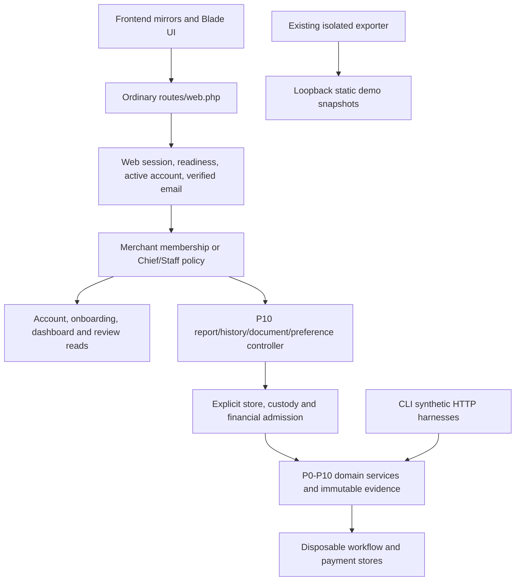

# XLipa R1 — Real Application Integration Audit

26 November 2026 · Owner-authorized read-only audit · Core payment gateway only

## A. Executive summary

**R1 STATUS: PASS as an integration audit. The application is not operationally ready.** The accepted P0–P10 implementation scopes and owner-approved Premium UI/UX are preserved. This audit adds documentation only; it implements no fix and authorizes no subsequent phase.

The repository contains substantial Laravel domain implementations and protected ordinary account, dashboard, onboarding/review and P10 routes. However, no complete payment-gateway journey is established through ordinary operational routes. Successful business-name completion, application submission, Chief decisions and P4–P9 financial/developer journeys depend on explicit test harnesses and independent admissions. Ordinary application submission still calls a fail-closed predecessor, not the completed P2 service. Most financial persistence DDL is in disposable fixture installers; P10 migrations alone cannot provision that dependency graph.

P10 remains accepted. Its actual routes are wired, while underlying stores, custody, workers and transports remain intentionally unprovisioned. The financial dashboard shown in the demo is supplied by the exporter, not by the ordinary dashboard controller. A route in `route:list`, a passing service test, and a static screenshot establish different layers of evidence.

Fresh R1 evidence: **184 existing tests / 1,947 assertions passed**, **44 ordinary route registrations inspected with middleware**, **40 protected pins verified**, and owned static demo health verified at 56 snapshots. No operational database or ordinary-site HTTP request was made. Source-preservation comparison is recorded in section B. Accepted P10 test/browser counts remain historical unless explicitly listed as freshly run here.

Retain **approximately 60% core development completion: 0 percentage-point change**. R1 improves understanding and planning, not implementation completion. R2 is recommended only after owner review, starting with a disposable ordinary-web staging/admission boundary. Do not switch global guards off or run the working database under synthetic flags.

## B. Repository and environment evidence

- Project: `C:/Users/hp/OneDrive/Desktop/WEB-DEVELOPMENT/XLipa`.
- Shared Git root: `C:/Users/hp/OneDrive/Desktop/WEB-DEVELOPMENT`; inspection was limited to XLipa plus applicable ancestor instruction checks.
- Branch: `main`; HEAD: `da7c94aeeb51cd6e42eea8932d7718c3ddcbe081`.
- Initial state: 16 modified tracked XLipa files and four untracked P10 documents/migration, all inherited from the accepted work. No index update, reset, clean, checkout, commit or push occurred.
- Modified at entry: premium recovery report; five P10 payment-action files; P10 controller; two P10 views; ordinary routes; dashboard/P10/demo-export tests; three demo scripts. Untracked at entry: official P10 specification, approved reconciliation, P10 report and additive P10 policy/document migration.
- `backend/AGENTS.md` read. No applicable ancestor/project AGENTS.md or `.ai/rules` directory was found. The referenced testing-best-practices skill is not in the supplied catalog. No skill requiring artifact creation or browser operation was needed for this Markdown/source audit.
- A preservation inventory captured **420 existing source/template/script/report files**, including uncommitted files. It excluded working database/sidecars, `.env`, credential files, storage, vendor, node_modules and generated demo exports. No operational data was hashed. Final comparison is recorded below after report completion.
- PHP 8.5 executable and installed Laravel/PHPUnit source are available; last accepted dependency inspection recorded Laravel 13.35.0, PHPUnit 12.5.38 and Pint 1.32.1. R1 did not install/update dependencies or run a mutating formatter.
- `frontend/` and `backend/` exist. `scripts/Sync-Frontend.ps1` copies canonical frontend HTML/assets into Blade/public mirrors. It was inspected, not executed. `backend/bootstrap/app.php` is the Laravel entry configuration; `backend/public/index.php` is the web front controller.
- `http://xlipa.test` is the historical Herd URL named in the launcher. Actual local site/DNS/runtime configuration was not queried: doing so could boot the operational app and use its database/session settings. No claim of fresh ordinary-site availability is made.
- Fresh GET of `http://127.0.0.1:18761/__demo-health` matched the recorded ownership token and returned 56 pages, `static-visual-only`. No demo process/state/export was changed. `xlipa.com.tz` remains a proposed future domain; ownership/purchase/hosting was not verified.

Final R1 deliverables are this report and `XLIPA-R1-INTEGRATION-MATRIX-2026-11-26.md`. Existing owner reports/specifications remain untouched. Temporary view compilation by existing isolated tests is not application-source implementation.

## C. Source-of-truth inventory and evidence rules

The user's pasted official R1 directive is the current authorization. Product decisions follow that directive, the official P10 specification and approved reconciliation; implementation status follows current source. D13-1 is explicitly present in the supplied P10/reconciliation documents: request advice on demand, payout receipt only after confirmation plus reconciliation. No historical document grants operational authority.

| Source inspected | Use and limitation |
| --- | --- |
| `XLIPA-P10-OFFICIAL-SPECIFICATION-2026-11-22.md` | Current P10 acceptance, D13-1 and integration constraints; accepted code retained |
| `XLIPA-APPROVED-REQUIREMENTS-RECONCILIATION-2026-11-22.md` | Approved core inventory, future scope and factual appended implementation evidence |
| `XLIPA-P10-IMPLEMENTATION-2026-11-22.md` | Accepted P10 counts/limits; historical evidence in R1, not freshly rerun P10 |
| `XLIPA-FINAL-PREMIUM-UI-UX-REFINEMENT-2026-11-22.md` | Owner visual acceptance and prior recovery history; older current-status statements superseded |
| `XLIPA-P9-IMPLEMENTATION-2026-11-21.md`, `XLIPA-P9-DEVELOPER-INTEGRATION.md` | Developer scopes, credential/webhook contracts and isolated-only endpoint context |
| P8 analytics/settlement report, P7 wallet report, P6 checkout report, P5 ledger report, latest November 19 P4 report, P3 decision report, P2 submission report, BNC-INT-07A and minimal-registration reports | Scope/status, recovered source, acceptance and operational limitations reviewed; not all historical assertions independently re-executed |
| `XLIPA-P0-REPOSITORY-CI-BASELINE-2026-11-14.md` | Filename is misleading: current contents/title and digest match the BNC-INT-07A report. P0 verifier/source and accepted logs, not this filename, establish P0 evidence |
| `XLIPA-MASTER-ROADMAP-ADDENDUM-R1-{1,2,3}-2026-11-06.md`, payments/analytics addendum, owner/security decision and B3.2/SE/BNC reports | Earlier proposals/contract history; later explicit owner decisions control; no old visual proposal overrides approved UI |
| `XLIPA-B3-2-C-WORKING-TARGET-SAFETY-AND-RECOVERY-PACKAGE-2026-11-07.md` and related operational-boundary reports | Independent per-action permits, release/store lineage, recovery holds; no execution against a working target |
| `scripts/verify-isolated.ps1`, bootstrap/TestCase/phpunit, frozen bnc1/b32c manifests, test harnesses and fixture installers | Current isolation, pin, route and schema evidence; working bindings/secrets not inspected |

Three requested filenames were **not found** in the project-wide Markdown inventory or exact checks at XLipa root, backend, frontend and shared Git root:

1. `XLIPA_MASTER_HANDOFF_ROADMAP_PRE_SELCOM_2026-11-13.md`.
2. `XLipa_Master_Project_Record_2026-11-06.md`.
3. `XLipa_Approved_Premium_UI_Codex_Prompt.md`.

Their absence prevents verification of any additional unpublished detail unique to those originals. It does not prevent the current bounded integration audit: the R1 directive and supplied approved reconciliation enumerate current requirements, and actual code supplies integration evidence. Unspecified commercial rates, legal/provider policy and future homepage details remain unresolved; none is invented. No separate original D13-1 source was found beyond the authoritative supplied consolidation. This report is not an exhaustive historical conversation reconstruction.

Evidence labels: **S** = fresh source inspection; **F** = fresh safe command/test; **H** = accepted historical evidence; **I** = inference requiring staging verification; **U** = unavailable/unknown. The matrix uses these labels and never upgrades H or S to an operational runtime PASS.

## D. Current architecture and execution boundaries



**Bootstrap and HTTP.** `bootstrap/app.php` loads `routes/web.php`, console routes and `/up`; no ordinary API route file is registered. Laravel's web middleware supplies sessions/CSRF. Authenticated routes add `AuthenticationResponseHeaders`, `auth`, `EnsureAuthenticationReady`, `EnsureActiveAuthentication`, verified-email middleware where required, and merchant context resolution. Host trust is the exact configured APP_URL host; subdomains are not automatically trusted. Guest redirects use named login/account routes. Sensitive workflow exceptions have generic responses/redacted logging; financial/P10 routes also inherit private headers, but operational error UX needs staged acceptance.

**Authentication.** `RegisterRequest` normalizes email/phone, permits blank business name, prohibits privilege fields and validates password length. `RegisterMerchantOwner` and `CreateMerchant` create the account/merchant/owner/draft/audit bundle within lifecycle mutation. Login rotates session ID and records auth_version; logout invalidates session/token. Signed verification links use Laravel notifications and `VerifyAccountEmail`. `EnsureAuthenticationReady` explicitly permits only local/testing and log/array mailers with required schema. It is a release restriction, not a production-ready auth binding. Password reset rejects the versioned workflow profile until lifecycle review; the foundation-profile success path does not prove composed-profile readiness.

**Tenant/roles.** `Merchant::forMember`, `ResolveMerchantContext` and `MerchantPolicy` establish active membership, verified active account and owner-specific mutation permission. Owners manage verification; owner/manager application detail rights differ from staff summary rights. `ResolvePlatformRole` and action-specific `PlatformRoleAssignmentPolicy` separate Chief and Staff. No wildcard Chief-as-owner policy exists. Financial/decision reads exclude conflicted Chief actors, including historical merchant memberships/submission involvement. Expanded role/team management is not implemented by these policy definitions.

**Onboarding.** The ordinary dashboard queries current records and renders `MerchantDashboardOverview`; it does not inject financial services. Onboarding GET supplies a guarded completion preview, with no ordinary completion POST. Verification endpoints resolve an unprovisioned `VerificationEnvironment` and exact-schema readiness. `MerchantApplicationController` calls `MerchantApplicationSubmission`, whose `submit(): never` always fails closed. Completed `ApplicationSubmissionService`/`ApplicationDecisionService` are separate, independently admitted implementations reached through harness routes. This is a concrete wiring gap beyond merely missing admission.

**Financial services and persistence.** `PaymentEngine`, `MockPaymentLedger`, links, wallet, `LedgerLifecycle` and `MerchantWithdrawals` use an explicitly supplied SQLite PDO `PaymentStore`, independently from Laravel's workflow connection. Financial intent/dispatch/confirmation, journal/seal and lifecycle records are separate facts. `PaymentStore` uses BEGIN IMMEDIATE, checks SQLite safety PRAGMAs, forbids nested writers, and quarantines unknown commit outcomes; workflow services reserve their own Laravel writer and fail closed on uncertain acknowledgement. Holding both does not create a distributed transaction. Future staging must preserve command IDs and reconcile outcomes rather than retry unknown commands blindly.

**Migrations.** Ordinary migrations include base users/cache/jobs; account/merchant/membership/platform-role/application/audit definitions; three synthetic verification migrations; and the two P10 migrations. b32c/se1/bnc1 composed definitions live under `database/activation/` with frozen profiles. P4–P9 payment/ledger/link/analytics/lifecycle/developer schemas are installed by `tests/Support/*StoreFixture.php`, not a complete ordinary migration chain. P10 DDL expects those tables and admitted services; running ordinary migrations is not sufficient financial provisioning. No operational schema was inspected.

**Providers and events.** PaymentProvider, PayoutProvider and ReconciledPayoutProvider are abstraction boundaries. Current implementations/signature codecs are fictional; lifecycle code also explicitly depends on FictionalFundsEvidence and fictional provider transaction semantics. Selcom replacement therefore requires an evidence-codec/authority review, not merely binding a different class. No Selcom contract is present or inferred. Merchant API supports scoped link creation/read and payment-state read; its harness does not expose an unrestricted direct financial-posting API.

**Notifications, reports and workers.** P10's normal routes call services only when explicitly bound. Events, recipient encryption, delivery claims/history, preference snapshots, digests, stored PDFs and download audits exist. The sweep/dispatcher is callable code, not a configured autonomous job/worker; `routes/console.php` registers only the sample inspire command. Payment/ledger authorization currently depends on current owner/auth/session evidence. Real background execution and stateless API execution need independently scoped principal design; forging browser sessions is not a production worker design. External notification transport is denied by default. Chief reporting is application-scoped unless an independently admitted merchant `p10.chief-context` is supplied.

**UI and demo.** Shared product CSS, role navigation, mobile controls and views are real Laravel templates. Financial dashboard values are injected by `SafeBrowserDemoExportTest` view composers; ordinary `MerchantDashboardController` supplies onboarding records only. Demo server reads allowlisted exported HTML/assets/fixed downloads, strips scripts, disables forms, requires loopback Host/peer and accepts GET/HEAD only. It never boots operational Laravel. It is a visual artifact, not authentication or transaction execution.

## E–F. Requirements inventory and integration matrix

The companion **[R1 integration matrix](XLIPA-R1-INTEGRATION-MATRIX-2026-11-26.md)** records all 24 requested dimensions in two keyed tables, with shared middleware/schema/evidence profiles explicitly defined. It covers registration, auth/session/verification/reset; membership and application lifecycle; identity/OTP; dashboard; payments/ledger/fees/refunds; links/checkout/wallet/funds; API/credentials/QR/buttons/webhooks; every P10 notification/document/export capability; analytics/advanced attribution; Chief/Staff; settings/team/localization/security; public UI/domain/recovery/performance; and the excluded Store concept.

No capability is classified as fully verified ordinary **operational** integration. Many are actual ordinary routes exercised in isolated fixtures. Others are production-intended services with test-harness endpoints only. Missing implementations, intended gates, unavailable evidence and future concepts are separately recorded.

## G. End-to-end journeys

| Journey | Last successful evidence | First ordinary missing/blocked step and exact boundary | Safe future approach / staging acceptance |
| --- | --- | --- | --- |
| 1. Registration → verification → dashboard → name → submission → review → decision | F: registration/login/verification/dashboard and review boundaries exercised in current fixture tests. H: full BNC/P2/P3 journeys through harnesses | After ordinary onboarding GET, there is no completion POST. Verification environment denies; ordinary submit calls `MerchantApplicationSubmission::submit(): never`, not completed P2 service. No ordinary decision POST | R2 admission/schema foundation, then reuse BNC/P2/P3 with explicit fictional issuer authority and Chief step-up scope. Separate real-phone proof policy from staging evidence. Demonstrate same fixture merchant through ordinary routes, retries/conflicts/revocation and immutable audits |
| 2. Product creation → checkout → confirmed payment → ledger → transactions | H: P4–P7 service/harness journey and accepted regressions | Ordinary dashboard has no admitted financial summary/product routes; P6 create/checkout are harness-only; P4/5 schema/provider/admission unbound | R2 approved ordinary routes and disposable payment store, fake provider/signed fixture events only. Prove distinct intent/confirmation/journal, tenant isolation, duplicate callback no duplicate posting, unknown outcomes and real route visibility |
| 3. Wallet → eligibility → request/reserve → payout → reconcile → receipt | H: P8/P10 fictional lifecycle, reconciliation and receipt tests | No ordinary wallet/funds mutation routes or FundsAdmission/destination authority; lifecycle requires CLI/testing/synthetic execution | R2 scoped fictional financial host/store and destinations. Confirm callback alone cannot issue payout receipt, concurrent reservations cannot overspend, failures release only after reconciliation, operational withdrawable stays disabled |
| 4. Credentials → API → payment → webhook | H: P9 scoped bearer/link/read, widget/checkout and webhook tests | Credential/UI/API routes are harness-only. API does not implement a direct payment-initiation endpoint; collection continues through link/checkout. Webhook transport is fictional and no worker is bound | Reuse current API contract; do not invent a new payment-write endpoint. R2 stateless scoped principal, ordinary staged API and local fake webhook sink; rotate/revoke/rate/replay/SSRF tests; no external egress |
| 5. Confirmed event → policy → delivery → history/report/export | H: accepted P10 4/260; S: actual P10 routes, sweep, intents and three formats present | Controller bindings absent, upstream financial services unavailable; no autonomous principal/scheduler/verified SMS resolver/real transport | R2 ordinary staged records plus independently admitted worker context and fake transport; verify event vs queue vs accepted vs delivered, free mandatory notices, immutable docs and export totals. Retention/legal exceptions remain gated |
| 6. Login → role workspace → review → decision/financial oversight | F: Chief/Staff workspace boundaries pass fixture tests; actual review/report GETs exist | Decision mutation absent; broader operations disabled; scoped financial report context unbound; privileged MFA not implemented | R2 existing review/decision/service integration; Chief must not gain merchant owner rights; R3 broader operations, R5 privileged assurance. Verify historical conflicts, Staff denials and scoped audit visibility |
| 7. External landing/link → attribution → checkout → analytics | H/S: first-party source capture, immutable provenance, authenticated fictional method evidence and reconciled cross-analysis | No ordinary checkout/capture/analytics integration; third-party redirect evidence may be unobservable; no authentic shortener/biolink integration | R2 first-party observable capture at staged checkout; R4 provider-agnostic adapters only with real contracts. Test preserved tags, exact referral mapping, spoofed/missing evidence → uncertainty/Unknown; no guessed networks, ROAS or unique customers |

“Last successful” refers to the named evidence layer. None of these journeys was run against operational data in R1.

## H. Security gate inventory

| Gate / location | Current purpose and enforcement | Bypass risk | Safe staging / required authority |
| --- | --- | --- | --- |
| `EnsureAuthenticationReady::handle` | Schema + local/testing + log/array mail only | Accidentally admits real environment/mail or an incomplete schema | R2 isolated ordinary-web profile reviewed separately; preserve operational deny; no global APP_ENV trick |
| `EnsureActiveAuthentication`, merchant/platform policies | Current account/auth_version, verified email, membership and role | Revoked session, cross-tenant access or Chief-as-owner | Retain for all staged routes; owner/security review for any new action permission |
| `DeniedBusinessNameCompletionAdmission` in AppServiceProvider | Default no trusted profile/time/store/retention/replay grant | Repeated/unauthorized completion or stale restored writer | R2 explicit scoped admission; trusted release/store lineage/time/recovery proofs, not request flags |
| `VerificationEnvironment` + `VerificationReadiness` | No custody/identity policy/delivery authority; exact schema/key domains required | Real NIN/OTP collection, fake proof promoted to live, quota bypass | Fictional data only in admitted staging namespace; real identity/legal/provider approval separate |
| `DeniedSubmissionAdmission`, `SubmissionEvidenceEnvironment`, `ApplicationSubmissionService::operational/trust` | Current proof, issuer custody, retention, authoritative restore and immutable evidence | Submission with stale/fake/replayed assurance | Do not relabel fixtures as genuine live proof. Stage explicit assurance model with reviewed contracts; separate real proof activation |
| `ApplicationDecisionAdmission` | Default false, no authority version/time; separate reviewer/step-up/policy grant | Unauthorized/conflicted final decision, approval confused with financial activation | Scoped Chief action grant, independent step-up, reason/retention policy and outcome resolution |
| `WorkflowSchemaReadiness`, TrustedReleaseApproval/TrustedStoreLineage interfaces, bnc1/b32c/se1 manifests | Exact complete profile, release hashes, writer lineage/fences, no schema inference | Mixed profiles, stale/duplicate writers, replay after restore | Frozen source changes require controlled new release/approval process; never regenerate pins merely to silence a mismatch |
| `PaymentAdmission`, explicit PaymentStore | Default payment/events false; no clock/PDO binding; current owner/evidence checks | Unauthorized payment creation/confirmation or wrong store | Disposable explicit store, operation-scoped fake provider grants; no operational PDO fallback |
| `LedgerAdmission` / `MockPaymentLedger` | Separate accounting permission, confirmation/source/postings/seal validation | Duplicate/forged credits, cash inferred from intent | Retain unique/sealed double-entry and exact TZS invariants; independently admitted staged posting |
| `PaymentLinkAdmission`, guest checkout guard | Default owner/customer denial; nonce/session/expiry and synthetic restrictions | Public arbitrary payment, link/tenant confusion, replay | Separate staged customer capability and ordinary routes; retain nonce and rate controls |
| `FundsAdmission`, `LedgerLifecycle::run`, `MerchantWithdrawals` | Default no settle/read/withdraw/admin/destination grant; CLI/testing/synthetic; authenticated evidence plus reconciliation | Overspend, false settled/paid funds, callback treated as receipt | Independently admitted fictional custody/destination/provider, reservations and reconciliation; no real payout activation |
| `MerchantDeveloperTools::guard/api`, MerchantWebhooks | Test-only execution, scoped hashed credentials, current authority, rate limits, encrypted signing keys and HTTPS/public-IP pinning | Public credentials/SSRF/replay/egress or shared-session impersonation | R2 stateless staging principal, local fake transport; preserve outbound deny, revocation and replay defenses |
| `P10ReportingController` binding checks | 503 when report/notification service unbound; owner Gate and tenant route context | Read from incorrect store/custody or leak private documents | Explicit approved bindings to disposable dependencies, not autowiring a real database |
| Optional `p10.chief-context`, ledger administrativeRead | Independently admitted merchant scope plus current Chief/non-conflict checks | Unscoped financial enumeration/Staff privilege escalation | Retain separate merchant scope; platform aggregation is later governed work |
| `DeniedNotificationTransport` | Throws; no external messaging adapter | Unapproved real email/SMS, billing or false delivery | Fake transport only; real recipient/custody/legal/delivery policy separately approved |
| `tests/bootstrap-isolated.php`, TestCase, phpunit and B32CRehearsal pins | Memory DB, absent env/cache sentinels, fake/null channels, test-only registration | Tests touching working data; harness imported as live capability | Preserve all four guards and their pin identities; never point testing flags at working SQLite |

All gates above remain necessary. Some runtime-specific guards need an owner-approved staging equivalent, not removal. No operational binding or key material was read to assess them.

## I. Financial integrity assessment

Source and accepted tests establish positive foundations: integer bounded TZS; merchant/provider/reference correlation; unique idempotency/event keys; monotonic/terminal state rules; durable dispatch-before-side-effect; unknown-commit quarantine; separate pending accounting and settlement; balanced sealed postings; reservation/release/payout journals; independent payout-query reconciliation; and tenant/conflict checks. They do not establish a real custody book or deployed provider.

The lifecycle projection reconciles `available + reserved = simulated settlements − completed fictional payouts`; operational available remains zero. Pending attempts are not posted confirmed revenue. Reported fee/refund/net categories explicitly remain unavailable without evidence, not assumed zero. Payout request/transport acceptance is not payout completion. P10 validates source and stored-document hash on retrieval.

No demonstrated current duplicate-posting, cross-tenant financial-write exploit or fabricated live-fund claim was found in this bounded audit. This is not penetration-test or production correctness certification. Important staging risks remain:

- Authority and payment stores use distinct transactions; no distributed atomicity guarantee. Lost acknowledgements require resolution, never blind redispatch.
- Reports call analytics, ledger read and funds read separately. **Inference:** under concurrent mutation, one exported document may combine different observation points; no common snapshot/watermark protocol is established. Test and resolve before ordinary concurrent financial acceptance.
- P5 intentionally supports its defined mock-payment book; fees, commercial net, refunds/reversals/disputes and production settlement controls require R3 contracts. Do not extend by overwriting historical entries or inferring provider capabilities.
- Denied service bindings are safety controls, not evidence of a missing bank balance or a reason to fabricate zeros.

## J–K. Preservation, real UI and demo comparison

All accepted P0–P10 source is retained, including the uncommitted P10 completion. Fresh selected ordinary-route fixture tests pass. Historical full financial/developer/P10/browser runs are reused with their dates and scope; no new global regression/visual PASS is claimed.

Ordinary account/onboarding/dashboard/review UI uses authorized Laravel records and truthful unavailable states. Merchant financial KPI/chart/transaction/source/method panels require variables supplied by the isolated exporter's view composers. Normal dashboard controller does not supply them. Quick actions and administrative future tools are conditionally disabled, not functioning operations. P10 forms/routes exist, but successful service execution remains separately admitted.

P10's mobile report table has a contained scroll area for unbroken amounts. Approved navy/blue/white CSS, mobile drawers/docks, desktop/tablet composition, icons and the homepage were preserved. Existing evidence includes 56 accepted viewport checks and PDF/XLSX checks, but R1 did not repeat a browser accessibility/device audit. Keyboard/screen-reader completeness, real browser auth/errors, loading/empty/unauthorized states across new ordinary financial routes remain staging acceptance work.

Two current presentation inconsistencies are source-confirmed: `account/show.blade.php` says notification/preferences are not implemented even though P10 exists; merchant navigation has a disabled Finance “Reports” entry and an actual Account “Reports” link. They are low-severity truth/discoverability issues for a later authorized fix, not permission for a dashboard redesign. Any earlier homepage enhancement is retained as an unspecified future item; no complete new approved homepage brief was recovered, and no change is inferred.

## L. Findings and priorities

Severity reflects the effect on the intended next stage; intentional gates are not labeled exploitable defects. **No CRITICAL defect was demonstrated.** No destructive/pentest activity occurred.

| ID / severity | Requirement and exact evidence | Impact / established cause | Recommendation, authority and milestone | Required acceptance evidence |
| --- | --- | --- | --- | --- |
| R1-H01 HIGH | A06–A09/F01–F05: ordinary routes vs `*HttpHarness.php`; ordinary `MerchantApplicationSubmission::submit(): never` | End-to-end business journeys stop despite completed services; missing ordinary adapters and stale submission wiring | Owner-authorized R2 reuse existing services under scoped staging admissions; do not turn on denials globally | Complete same-merchant ordinary-route journeys with negative auth/replay/unknown-outcome tests |
| R1-H02 HIGH | `database/migrations/` vs `tests/Support/{Payment,Ledger,PaymentLink,Analytics,Lifecycle,Developer}StoreFixture.php` | Financial schema deployment/lineage chain not ordinary-provisioned; P10 schema is only a dependent extension | R2 reviewed disposable migration/provisioning/compatibility package; protected release procedure approval required | Blank disposable target → exact schema → replay/conflict/restore fences; working DB remains inaccessible |
| R1-H03 HIGH | `EnsureAuthenticationReady::handle`, `PasswordResetController::reset`, financial CLI/testing checks | No approved ordinary-web staging runtime; versioned-profile reset remains held | R2 staging identity/runtime contract; R5 security assurance before real access, preserve operational holds | Normal web-SAPI tests, isolated host/session/store enforcement, denied operational target and versioned reset lifecycle acceptance |
| R1-H04 HIGH | `TrustedReleaseApproval`, `TrustedStoreLineage`, denied admissions/custody interfaces | Deployment authority, key custody and authoritative restore cannot be established from role rows/local hashes | R2 minimal scoped staging authority; R5 durable custody/recovery, independent owner/security approval | Revocation/outage/stale store/replayed permit/restore tests; no permissive runtime switch |
| R1-H05 HIGH | `FictionalMockProvider::capabilities` refunds false; reports mark fees/net unavailable; no commercial rules/refund workflow in app/routes/migrations | Approved core fees/refund/dispute/accounting requirements incomplete | R3 approved rule/adjustment contracts, no invented rates or Selcom refund contract | Exact TZS/versioned immutable fee snapshots; gross/provider/platform/net and adjustment reconciliation; authorization/idempotency |
| R1-H06 HIGH before live privileged access | No MFA/step-up workflow in ordinary auth/routes; decision admission explicitly expects independent privileged assurance | Privileged operational readiness incomplete; existing role check is not MFA | R5 (with R2 admission prerequisite), approved privileged policy/custody/recovery | Chief mandatory MFA, sensitive-action step-up, revocation/recovery and role-separated acceptance |
| R1-M01 MEDIUM | Notification sweep/deliver require owner-bound ledger reads; console routes have no worker; 1,000-source cap | Autonomous delivery/backlog handling not integrated; current session-bound authority is unsuitable as an assumed worker principal | R2 independent scoped worker/API principal and fake transport; R5 bounded cursor/load/recovery review | Restart/crash/lease/idempotency tests, no merchant-session fabrication, accepted != delivered; >1,000 backlog handling |
| R1-M02 MEDIUM (inference) | `MerchantFinancialReports::report` separately invokes analytics, financialRead and funds run | Concurrent report components could have different cutoffs; no staging concurrency evidence | R2 explicit report snapshot/watermark contract; R5 concurrency/performance | Deliberately interleaved confirmation/settlement/export with reconciling period and balance evidence |
| R1-M03 MEDIUM | `MerchantDeveloperTools::checkoutUrl` returns literal `http://xlipa.test/__isolated-checkout/` | Generated widgets are not ready for ordinary staged URL/domain migration | R2 named route/config boundary; R5 domain/callback security review | All widget/QR/button URLs match approved staged origin and real route; no production-host assumption |
| R1-M04 MEDIUM | First-party MerchantAnalytics vs absent external adapters | Redirect/shortener/campaign-click coverage incomplete; UTMs cannot prove external origin | R4 authentic provider-agnostic evidence contracts, privacy/owner review | Observable evidence and Unknown fallback across one-link/landing flows; no forced XLipa shortener/guaranteed attribution |
| R1-M05 MEDIUM | Recovery package specifies operational holds; no operational backup/restore/load evidence inspected | Production recovery/security/performance readiness unestablished | R5 isolated encrypted backup/restore, incident/worker/dependency/load acceptance | Owned disposable encrypted recovery rehearsal, independently fenced writers and measured bounds; no working-DB access |
| R1-L01 LOW | `resources/views/account/show.blade.php#notifications`; merchant navigation Finance/Account Reports | Stale availability copy/duplicate disabled entry causes confusion; accepted P10 source exists | Later targeted R2 integration/UI consistency fix under owner approval; no redesign | Truthful gated availability, exact destinations, retained role/viewport checks |
| R1-I01 INFORMATIONAL | P0 report has BNC title/content and identical source digest | Filename alone is unreliable historical evidence | Future documentation correction with approval; rely on actual verifier/source/logs now | Correct provenance and preserved historical record; no acceptance-count inflation |
| R1-I02 INFORMATIONAL | P10 accepted defaults/limits and exact admission gates | First-observation digests, ASCII PDFs, one-merchant Chief context are documented scope choices, not newly approved commercial/legal policy | R2 policy confirmation, R3 platform reports, R5 scale/retention, R6 acceptance | Explicit period/preference decisions, legal exception decisions, real-provider delivery evidence when separately authorized |

## M–N. Remaining approved requirements, decisions and external dependencies

Approved but not established as complete ordinary functionality: business-name completion/submission/resubmission/Chief mutations; integrated financial dashboard, products, wallet, transactions, settlements/withdrawals; staged API and workers; broad Chief merchant/payment/provider/risk/support/staff/settings operations; complete Pricing & Fees; refunds/reversals/disputes; team/contact/security editors; merchant/privileged MFA and step-up; Kiswahili/English localization; universal attribution extensions; production-grade encrypted recovery, dependency/release assurance and performance acceptance.

Existing membership/policy models are not team-management CRUD. Existing generic jobs/cache tables are not P10 workers. Unsupported expanded role catalogs remain unapproved. Existing provider interfaces are not Selcom approval. Exact rates, refund/partial-refund authority, provider financial semantics, proof collection/legal eligibility, key custody/rotation/revocation, mandatory notice exceptions, document wording/retention and platform-wide Chief financial scope need explicit decisions/evidence. No production domain purchase/ownership is assumed.

## O. Ordered R2 implementation plan — proposed only

Every step needs explicit R2 authorization; protected-contract amendments additionally need the existing controlled release/security process. No R2 file or feature was implemented in R1.

| Order | Proposed sub-milestone | Reuse and bounded scope | Acceptance / rollback and NO-GO |
| --- | --- | --- | --- |
| R2.1 first | Ordinary-web disposable staging and admission foundation | Separate isolated host/environment, owned disposable workflow/payment stores, deny-by-default capability bindings, fictional issuer/provider/transport namespace, current account/tenant/Chief policies. Design a web-SAPI admission equivalent rather than spoofing CLI/testing or binding fakes to operational data | Prove failure before any operational store connect, strict host/session/target isolation, named actor/action/tenant grants, revocation/restore fences and outbound deny. Approve exact schema/profile changes before code. Rollback disables the staged site/capabilities; no working target touched |
| R2.2 | Reviewed persistence and schema composition | Reuse immutable fixture/activation contracts as reviewed source material; add production-intended disposable migration/provisioning/compatibility paths for P4–P9 before P10 dependencies. Preserve frozen releases, do not silently edit their SQL/pins | Blank isolated DB, schema identity/constraints/seals, exact failure/restart behavior and migration review. Do not use destructive down on immutable history; retain isolated prior DB and use forward correction/retirement policy |
| R2.3 | Onboarding → submission → Chief decision | Reuse RegisterMerchantOwner, BNC service, ApplicationSubmissionService, decision service and existing read controllers. Add narrow ordinary adapters with expected versions/request IDs; replace obsolete wiring only after assurance design approval | Full same-owner/merchant ordinary route journey, optional name, no phone prerequisite for initial dashboard, no fake proof represented as live; resubmission concurrency, historical Chief conflicts, stale sessions, denied/revoked grants and unknown outcome resolution |
| R2.4 | Products → checkout → mock confirmation → ledger | Add ordinary staged P4–P6 routes/controllers, service bindings and private audit/status responses; reuse existing payment/link/ledger code. Signed fictional callbacks accepted only inside the isolated staging boundary | Fixed amounts currently implemented; any variable-amount policy requires explicit contract. Guest nonce/expiry/disabled link/rate/duplicate protections; terminal confirmation and exactly one sealed posting; lost acknowledgement not redispatched; no real provider access |
| R2.5 | Wallet, transactions and fictional funds lifecycle | Ordinary read routes plus individually admitted request/reserve/settle/reconcile actions; reuse wallet/lifecycle/withdrawal services, current projections and receipt sources | Prevent double counting/overspend; callback alone not payout receipt; independent reconciliation and failed release; owner vs Chief grants separate; ordinary views reflect authoritative staged records, not exporter composers |
| R2.6 | Developer products | Stateless API principal/capability design, ordinary credential/QR/button/link/API routes, configured named checkout URLs, local fake webhook sink; reuse current scopes/hash/rotation/replay/DNS/egress controls | No session impersonation shortcut, no direct arbitrary payment-posting endpoint, no public/live credentials, no external webhook traffic. Cross-tenant/revocation/expiry/rate/SSRF/replay tests; docs describe actual staged routes |
| R2.7 | P10 ordinary integration and background reads | Bind existing reports/docs/preferences to admitted stores; integrate scoped autonomous sweep/dispatch and fake-recipient resolver. Confirm documented first-observation/Monday/preference semantics and report snapshot contract with owner | No new P10 rebuild. Normal pages/exports/private docs work from ordinary staged records; free notices, acceptance != delivery, Off vs mandatory behavior, restart/idempotency and report reconciliation; legal/live transport exceptions stay denied |
| R2.8 | Consolidated staging acceptance/handoff | Existing P0–P10 tests plus real web-SAPI ordinary route/auth/browser journeys, failure/empty/loading/unauthorized UX and scoped financial error handling | Preserve protected pins or separately approved release versions; compare source baselines, disposable concurrency tests and full critical journeys. Retire only verified owned disposable assets under approved rollback. Do not deploy, use working SQLite, collect identity, send messages, connect Selcom or begin R3 automatically |

This order follows dependency evidence: runtime/authority → persistence → eligible merchant → confirmed payment/ledger → funds/developer/notification consumers. It avoids building another demo or repeatedly rewriting completed services. Full operational MFA/custody is not deferred past real privileged access; staging must remain fictional/isolated while those independent R5 gates are unresolved.

## P. R3–R7 mapping, retained feature freeze

- **R3:** pricing (percent/fixed/hybrid/min/max/tier/override/effective-version/audit), immutable fee evidence, approved refunds/reversals/disputes, remaining merchant/Chief/Staff/settings/support operations and platform financial reports. Product/rate/provider decisions required where unresolved.
- **R4:** merchant-freedom-first universal attribution, observable click/campaign/checkout mapping, direct/third-party shorteners/biolinks/custom domains/redirects, optional authentic 66biolinks adapters; Unknown/privacy preserved.
- **R5:** independent keys/custody/rotation/revocation, privileged/merchant MFA and step-up, retention and legal policy, domain/HTTPS/cookies/trusted proxies, backup/restore/incident recovery, worker security, dependency/release controls, concurrency/performance/large exports and cursor-based notification processing.
- **R6:** complete ordinary provider-independent staging journeys with mock proof, disposable persistence, negative/concurrent/recovery cases and browser/accessibility acceptance.
- **R7:** consolidate pre-Selcom readiness, remaining risk and exact legal/provider/operations NO-GO gates. Real Selcom integration requires official contracts/credentials and separate authorization; launch is another decision.
- **XLipa Store:** post-launch Phase 2 only, excluded from R1–R7 and completion percentage. No storefront/catalog/single-product Store work planned here. Merchants' own external landing pages remain supported product context.

## Q. Verification and limitations

Fresh R1 command from `backend/`:

```text
C:/Users/hp/.config/herd/bin/php85/php.exe
  -d auto_prepend_file= -d auto_append_file=
  -d allow_url_fopen=0 -d allow_url_include=0
  -d disable_functions=curl_exec,curl_multi_exec,fsockopen,pfsockopen,stream_socket_client,socket_create,socket_connect,socket_sendto,socket_sendmsg
  vendor/phpunit/phpunit/phpunit --configuration phpunit.xml
  --bootstrap tests/bootstrap-isolated.php --no-progress --do-not-cache-result
  tests/Feature/AuthenticationTest.php tests/Feature/MerchantDashboardTest.php
  tests/Feature/AdminWorkspaceTest.php tests/Feature/MerchantAccessTest.php
  tests/Feature/MerchantApplicationSubmissionTest.php tests/Feature/TrustedHostsTest.php
```

**PASS: 184 tests, 1,947 assertions, exit 0, 58,013 ms; no failures/skips reported.** Inspected bootstrap/TestCase ensure absent real environment/cache paths, in-memory SQLite, fake notification/log/array channels and HTTP stray-request prevention. Existing tests alone ran; no test was edited. P10 tests were not rerun because their fixed-path PDF evidence writes would replace previously accepted artifacts; accepted P10 results are sufficient historical evidence for this audit.

Fresh `route:list --except-vendor -vv --no-interaction` ran using the same synthetic bootstrap, explicitly selecting tests as environment path before Laravel boot. **44 registrations inspected**, with full middleware chain. The command lists registered web routes; it does not demonstrate successful auth/service/persistence at operational runtime. `/up` is configured in bootstrap but omitted by the except-vendor listing; no claim of only 44 total framework endpoints.

Fresh static protected-pin verification parsed expected SHA-256 maps from the existing verifier, validated the three frozen manifest hashes before their source maps, then checked b32c foundation and four INT-05/four isolation pins. **40 unique pins PASS**. It did not run migrations, mutate format, regenerate manifests or hash operational data.

Fresh static demo ownership health: **56 snapshots**, read-only server. No new browser QA, demo export or PDF/XLSX artifact generation in R1. Historical accepted evidence retained: P10 4/260; affected regression 160/7,542; dashboard 31/404; P0 functional 33/971; bounded 546/4,910; export 1/294; browser 56 checks; independent XLSX and PDF visual QA. These suites overlap and are not summed into a unique total. Relevant accepted logs remain `.recovery/p10-completion-*.log`, final browser QA `.recovery/ui-ux-evidence-1795725207932/qa.json`.

No ordinary-site request, operational database connection/integrity/hash/copy, dependency vulnerability network audit, production process/config inspection, real delivery/provider test, full browser/accessibility audit, load test, encrypted operational backup/restore or exhaustive exploit assessment occurred. Some source discovery attempts had corrected PowerShell glob/argument errors; they made no application changes and are not test failures. Missing documents and inference limits are disclosed above.

## R. Progress

Previous accepted estimate **approximately 60%**; current **approximately 60%**; **change 0 percentage points**. Existing P10/UI are not counted again and audit documentation is not feature implementation. No agreed weighted denominator exists.

| Dimension | Evidence-based status |
| --- | --- |
| Core development | Substantial P0–P10 source accepted in documented scopes; later core backlog remains |
| Ordinary application integration | Accounts/read surfaces and P10 adapters exist; successful core financial/onboarding mutation chains remain incomplete/gated |
| Provider-independent staging readiness | Not yet established through an approved ordinary-web runtime and provisioned disposable schema/authority chain |
| Security/operational readiness | Independent authority/custody/MFA/recovery/worker/retention evidence incomplete; fail-closed controls preserved |
| Official Selcom integration readiness | Blocked: no official contract/credentials/authorization; no provider capability invented |
| Production go-live readiness | NO-GO; separate acceptance/legal/provider/operations/deployment decisions required |

No unsupported exact percentages are assigned to the latter five categories. Store remains excluded.

## S–T. Operational NO-GO and final recommendation

Working SQLite/WAL/SHM untouched: no reads, hashes, copies, migrations or modifications. No operational secrets, `.env`, keys or release bindings were accessed/exposed. No source/test/migration/config change, dependency install, identity collection, OTP/email/SMS/webhook transmission, real payment/payout/settlement, Selcom connection, commit, push or deployment. Demo was not restarted or refreshed. Findings were documented, not fixed.

R1 acceptance is satisfied by established source/repository state, the complete keyed integration inventory, journey/gate/risk analysis, preserved accepted functionality, scoped fresh evidence and actionable ordered R2 plan. An audit PASS does not certify the audited application's readiness.

**Next recommended authorization: R2.1 — Ordinary-web disposable staging and admission foundation**, with an explicit reviewed capability/assurance/schema design and no operational target access. Remaining R2 phases follow only that approved boundary. Protected release contracts require their own controlled amendment process if a proposed staging design needs changes.

**STOP FOR OWNER REVIEW. R2–R7, Selcom and deployment have not started.**
